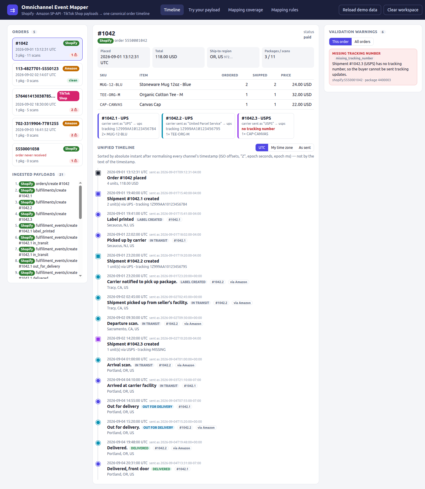
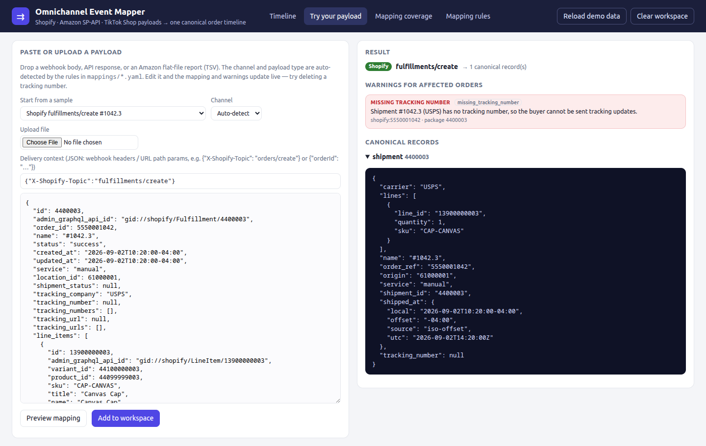
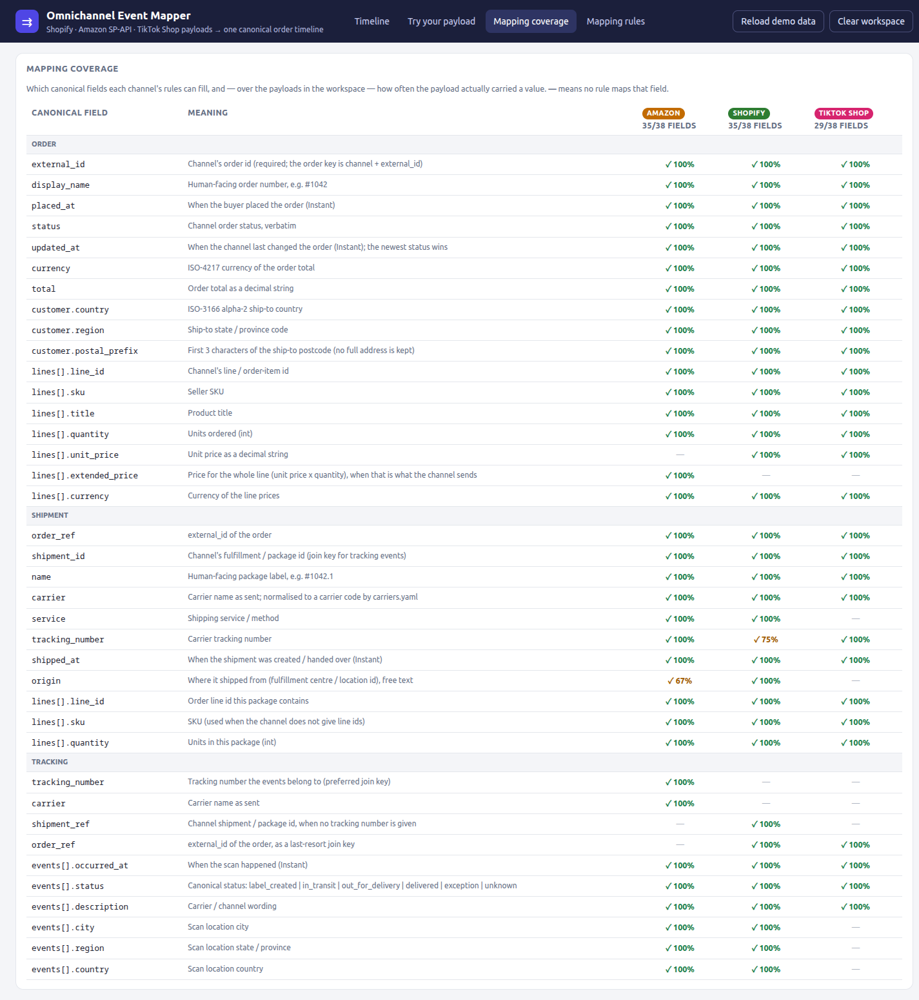

# omnichannel-event-mapper

**Take the order and shipment payloads a merchant already gets from Shopify, Amazon SP-API and TikTok
Shop, map them onto one canonical schema with declarative YAML rules, and show a single time-zone-correct
tracking timeline per order, with the data-quality problems flagged.**

This is a small local web app. It is built as a pre-sales integration demo: a prospect pastes their own
sample payload and immediately sees how it maps, which canonical fields their channel fills, and what is
wrong with the data (for example, a fulfillment with no tracking number).



In the screenshot above, Shopify order **#1042** is built from three kinds of payload: an
`orders/create` webhook, three `fulfillments/create` webhooks, and carrier scans. Package #1042.1 was
shipped by the merchant, and its scans arrive as Shopify `fulfillment_events/create`. Package #1042.2
was fulfilled from Amazon FBA inventory through Multi-Channel Fulfillment, and its scans come from
SP-API `getPackageTrackingDetails`. They are joined to the Shopify fulfillment by tracking number. The
carrier was sent as `"UPS"` on one package and `"United Parcel Service"` on the other, and both
normalise to `ups`. Package #1042.3 has no tracking number, so the warnings panel flags it.

The timeline is sorted by absolute instant. The Amazon "Arrival scan" (`2026-09-04T01:00:00Z`)
correctly appears *before* the Shopify scan sent as `2026-09-03T21:10:00-07:00` (04:10Z), even though
the text of the Shopify timestamp sorts first.

## Features

- **Declarative per-channel mapping.** Each channel is one YAML file
  ([shopify](src/omnimap/mappings/shopify.yaml), [amazon](src/omnimap/mappings/amazon.yaml),
  [tiktok](src/omnimap/mappings/tiktok.yaml)). The rules cover detection, paths, coalescing, type
  coercion and status lookups. The engine has no channel-specific code, and a rule that writes a
  non-canonical field fails at load time.
- **Auto-detection** of payload type from webhook headers (`X-Shopify-Topic`) or from the payload's shape.
  URL-path values, such as SP-API `confirmShipment`'s `{orderId}` or TikTok's `/orders/{order_id}/tracking`,
  come in through a delivery *context*, the same way a real integration receives them.
- **Carrier normalisation** from a single alias table ([carriers.yaml](src/omnimap/mappings/carriers.yaml)).
  Matching ignores case and punctuation. Unknown names are flagged rather than guessed.
- **Time-zone-correct merging.** Timestamps can be ISO with an offset, `Z`, naive + assumed zone, epoch
  seconds (TikTok orders) or epoch milliseconds (TikTok tracking). Each becomes an Instant that keeps both
  UTC and the original value. The UI can show UTC, your time zone, or the value as sent.
- **Order-independent, idempotent merge.** A fulfillment that arrives before its order, scans that
  arrive before their package, or a webhook delivered twice all give the same unified view. Order status
  is taken from the newest `updated_at`, not from whichever payload arrived last.
- **Validation warnings panel:** missing tracking number, unknown carrier, shipment for an unknown
  order, quantity shipped > ordered, timestamps out of order, currency mismatch, plus mapping errors.
- **Paste / upload box.** Paste JSON or an Amazon flat-file report (TSV), optionally pick a channel,
  and add headers as context. The mapping and warnings update live as you edit, before anything is
  committed to the workspace.
- **Mapping coverage report.** For every canonical field and channel, it shows whether a rule maps the
  field and how often the ingested payloads actually carried a value.
- **Privacy by construction.** The canonical schema keeps country, region and a 3-character postcode
  prefix only. Buyer names, streets, emails and phones are never copied.

| Try your own payload | Mapping coverage |
|---|---|
|  |  |

## Quick start

Requires Python 3.10+.

```bash
git clone https://github.com/brepre109/omnichannel-event-mapper.git
cd omnichannel-event-mapper
python3 -m venv .venv && . .venv/bin/activate
pip install -e '.[dev]'

omnimap serve            # http://127.0.0.1:8710, preloaded with the synthetic demo payloads
pytest                   # 94 tests
```

CLI without the UI:

```bash
omnimap check            # ingest every demo fixture, print the validation warnings
omnimap coverage         # canonical field x channel coverage table
omnimap map src/omnimap/fixtures/demo/30-tiktok-order-detail.json
omnimap map my-webhook.json --context '{"X-Shopify-Topic": "fulfillments/create"}'
```

`omnimap serve --no-demo` starts with an empty workspace. `--port` changes the port.

## Demo data

The payloads in [`src/omnimap/fixtures/demo/`](src/omnimap/fixtures/demo) are synthetic: the ids,
SKUs, tracking numbers and addresses are all invented. They are trimmed to the relevant fields. The
data covers four orders plus one orphan fulfillment, and it deliberately contains exactly one example of
each validation problem:

| order | payloads | what it shows |
|---|---|---|
| Shopify #1042 | orders/create, 3× fulfillments/create, 5× fulfillment_events/create, SP-API MCF tracking | split shipment, cross-channel scan join, carrier aliasing, **missing tracking number** |
| Shopify #1038 | fulfillments/create only | **shipment for an unknown order** |
| Amazon 113-… (MFN) | getOrder, getOrderItems, confirmShipment | clean order |
| Amazon 702-… (FBA, amazon.ca) | getOrder, getOrderItems, Amazon Fulfilled Shipments report (TSV) | **over-shipped** line, **currency mismatch** |
| TikTok Shop 5764… | Get Order Detail, Get Tracking, ORDER_STATUS_CHANGE and PACKAGE_UPDATE webhooks | epoch timestamps, one-line-per-unit items, **unknown carrier**, **scan before shipment** |

## Architecture

```
payload + context ─► MappingSet.map ─► detect (YAML `detect`) ─► apply (YAML `emit`) ─► canonical records
                                                                                         │
      Workspace.sources (every payload kept) ─► Workspace.build(): merge by id, normalise carriers,
                                                join tracking by number → shipment ref → order ref
                                                         │
                                  ┌──────────────────────┼──────────────────────┐
                              timeline()             validate()             coverage()
                                  └────────── Flask JSON API ─► static single-page UI
```

- `paths.py`: the small path language (`a[*].b`, `list[key=value]`, `^.` parent, `$ctx.`).
- `transforms.py`: Instants and value coercion. `carriers.py`: alias table.
- `mapping.py`: loads the YAML, checks it against `schema.py`, and detects and maps payloads.
- `store.py`: the workspace. It rebuilds the unified view from every record on each read, which is what
  makes arrival order irrelevant. This favours correctness over speed and is fine at demo scale.
- `validate.py`: one plain function per rule, registered with a decorator.
- `app.py` / `static/`: Flask API and a dependency-free HTML/JS page (no build step).

More detail: [canonical schema](docs/SCHEMA.md) · [adding a new channel](docs/ADDING_A_CHANNEL.md).

**Tech stack:** Python 3.10+, Flask, PyYAML, pytest, and vanilla JS/CSS.

## Payload shapes and doc citations

The fixture shapes were checked field by field against the public documentation on 2026-09-27.

| payload | docs | notes |
|---|---|---|
| Shopify `orders/create` | [Order resource](https://shopify.dev/docs/api/admin-rest/latest/resources/order), [webhook headers](https://shopify.dev/docs/apps/build/webhooks) | Topic arrives in `X-Shopify-Topic`. `price` / `total_price` are strings. `currency` is the shop currency. |
| Shopify `fulfillments/create` | [Fulfillment resource](https://shopify.dev/docs/api/admin-rest/latest/resources/fulfillment) | `tracking_company`, `tracking_number`, `tracking_numbers[]`, `name` like `#1001.1` |
| Shopify `fulfillment_events/create` | [FulfillmentEvent resource](https://shopify.dev/docs/api/admin-rest/latest/resources/fulfillmentevent) | All 12 documented `status` values are mapped. `order_id` is marked deprecated, so the join uses `fulfillment_id`. |
| SP-API `getOrder` / `getOrderItems` (Orders v0) | [getOrder](https://developer-docs.amazon/sp-api/reference/getorder), [getOrderItems](https://developer-docs.amazon/sp-api/reference/getorderitems), [model JSON](https://github.com/amzn/selling-partner-api-models/blob/main/models/orders-api-model/ordersV0.json) | `ShippingAddress` City/StateOrRegion/PostalCode/CountryCode need no Restricted Data Token. `ItemPrice` is the line total. |
| SP-API `confirmShipment` (MFN) | [confirmShipment](https://developer-docs.amazon/sp-api/reference/confirmshipment) | This is the *request* body the seller POSTs to `/orders/v0/orders/{orderId}/shipmentConfirmation`. `orderId` comes from context. |
| FBA "Amazon Fulfilled Shipments" report | [FBA report types](https://developer-docs.amazon/sp-api/docs/report-type-values-fba) | Tab-delimited. The fixture keeps 29 of the report's columns and drops the buyer-PII columns. |
| SP-API `getPackageTrackingDetails` (Fulfillment Outbound 2020-07-01) | [reference](https://developer-docs.amazon/sp-api/reference/getpackagetrackingdetails), [model JSON](https://github.com/amzn/selling-partner-api-models/blob/main/models/fulfillment-outbound-api-model/fulfillmentOutbound_2020-07-01.json) | Multi-Channel Fulfillment packages. The `EVENT_1xx`–`EVENT_8xx` codes are mapped to canonical statuses. |
| TikTok Shop Get Order Detail (202309) | [docs](https://partner.tiktokshop.com/docv2/page/650aa8ccc16ffe02b8f167a0) | `create_time` is epoch seconds and amounts are strings. **Line items have no quantity: each unit is its own line item.** Each line item names its `package_id` / `tracking_number`. |
| TikTok Shop Get Tracking (202309) | [docs](https://partner.tiktokshop.com/docv2/page/650aa630c16ffe02b8f11803) | `GET /fulfillment/202309/orders/{order_id}/tracking`. `update_time_millis` is in milliseconds. |
| TikTok Shop webhooks | [ORDER_STATUS_CHANGE (type 1)](https://partner.tiktokshop.com/docv2/page/650300b8a57708028b430b4a), [PACKAGE_UPDATE (type 4)](https://partner.tiktokshop.com/docv2/page/650955cabace3e02b73cc886) | Envelope `{type, tts_notification_id, shop_id, timestamp, data}`. PACKAGE_UPDATE signals a combine/split, not tracking. |

**Not verified / invented:**
- The wording of the TikTok tracking `description` values in the fixture is invented. Get Tracking
  returns free text, so the TikTok status mapping is a substring heuristic (`contains:` rule), and the
  documented `action_code` field is not used.
- `service: "amazon-mcf-app"` on the Shopify fulfillment is an invented app handle.
- TikTok's `recipient_address.district_info` level names ("State") and the `address_level` "L1" used to
  pick the region follow the documented structure, but their values are made up.
- Shopify now calls the REST Admin API legacy, although webhook payloads are still REST-shaped. SP-API
  also has a newer Orders API version (2026-01-01) that this project does not map.

## Status / limitations

- This is an MVP demo, not a production integration. It does not verify webhook signatures (HMAC), call
  any live API, paginate, or handle rate limits. All state is in memory: restarting clears pasted
  payloads and reloads the demo.
- The unified view is rebuilt on every request. That is simple and order-independent, and fine for
  hundreds of payloads, but it is not meant for a real event stream.
- For Amazon marketplace orders, SP-API has no carrier-scan feed. Scans are mapped only for MCF packages
  (`getPackageTrackingDetails`), so the demo's MFN/FBA Amazon orders show order and shipment events
  without scans.
- TikTok Get Tracking is per order. When an order has several packages, its scans are shown as "not
  linked to a specific package" and are not checked against a ship time. The TikTok ship time is
  `rts_time` (the seller marked it ready to ship), because Order Detail has no per-package ship time.
- The mapping language does no arithmetic, so it cannot, for example, turn Amazon's line total into a
  unit price. That is deliberate: those cases are recorded in separate canonical fields.
- Only three channels are mapped, and only the payload types listed above.

## License

MIT. See [LICENSE](LICENSE).
